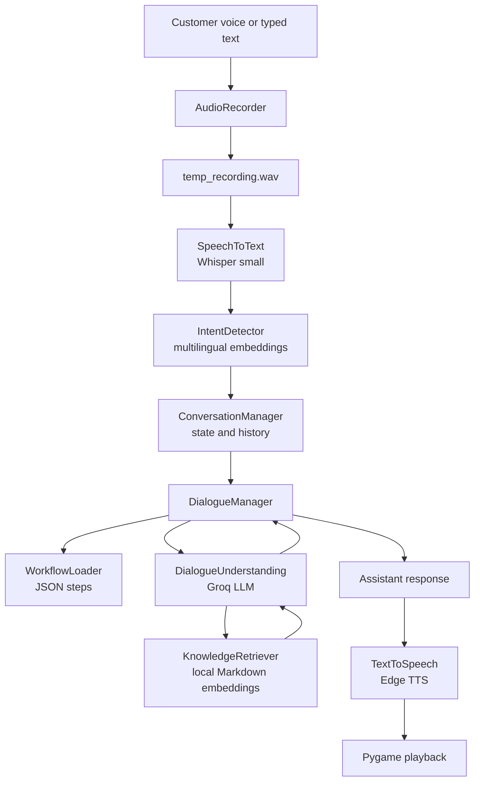
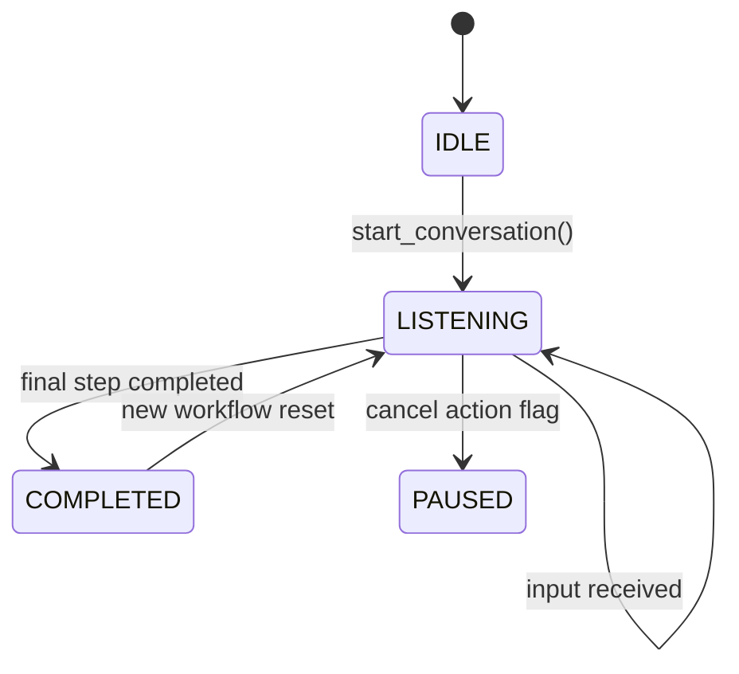

# Smart Banking Voice Assistant

## 1. Overview

This repository contains a Python desktop voice assistant prototype for common banking branch tasks. It accepts spoken input, converts speech to text, detects the requested banking service, guides the customer through a predefined workflow, answers banking questions from local Markdown knowledge, and can read responses aloud.

The current implementation is a command-line application. It is not a web service, mobile application, database-backed banking system, or transaction-processing system. The workflows provide guidance only; they do not access accounts, verify identity, move money, or submit forms to a bank.

### Supported intent labels

- `deposit money`
- `withdraw money`
- `check account balance`
- `apply for loan`
- `open new account`

### Currently executable guided workflows

- Deposit: `app/workflow/workflows/deposit.json`
- Withdrawal: `app/workflow/workflows/withdraw.json`
- Loan application: `app/workflow/workflows/apply_for_loan.json`

`check account balance` has an intent label but no workflow mapping in the interactive loop. `open new account` is mapped to `account_opening`, but `account_opening.json` is absent, so the workflow loader returns no workflow for it.

## 2. Technology Stack

| Area                | Technology used                                                      | Role                                                               |
| ------------------- | -------------------------------------------------------------------- | ------------------------------------------------------------------ |
| Language            | Python                                                               | Application and module implementation                              |
| Runtime             | Python 3.13 appears to be used by the checked-in virtual environment | Local execution environment                                        |
| Audio input         | `sounddevice`                                                        | Records mono microphone audio                                      |
| WAV writing         | `scipy.io.wavfile.write`                                             | Saves recordings as WAV files                                      |
| Speech recognition  | OpenAI Whisper Python package, model `small`                         | Converts audio to text locally                                     |
| Text embeddings     | `sentence-transformers`                                              | Semantic intent and knowledge matching                             |
| Intent model        | `paraphrase-multilingual-MiniLM-L12-v2`                              | Matches multilingual user text to intent labels                    |
| Action model        | `all-MiniLM-L6-v2`                                                   | Legacy/local semantic action detector                              |
| Similarity          | `scikit-learn` cosine similarity and NumPy                           | Ranks intent matches                                               |
| LLM provider        | Groq Python SDK                                                      | Calls the dialogue understanding and question-answering model      |
| LLM model           | `openai/gpt-oss-20b`                                                 | Structured message classification and grounded answers             |
| Structured output   | Groq/OpenAI-compatible JSON schema response format                   | Forces the understanding response into a defined schema            |
| Knowledge format    | Markdown files                                                       | Local banking facts and policies                                   |
| Knowledge retrieval | Sentence embeddings plus dot-product ranking                         | Selects relevant Markdown documents                                |
| Text to speech      | `edge-tts`                                                           | Generates MP3 speech using Microsoft Edge online voices            |
| Audio playback      | `pygame` mixer                                                       | Plays generated MP3 files                                          |
| Translation         | Custom `Translator` class                                            | Currently pass-through; no actual translation service is connected |
| Data formats        | JSON                                                                 | Workflow definitions and LLM structured output                     |

There is currently no `requirements.txt`, `pyproject.toml`, or other dependency lockfile in the project root. Install packages manually or create a dependency file before sharing or deploying the project.

## 3. High-Level Architecture



## 4. End-to-End Runtime Flow

### 4.1 One-shot application path

The normal application entry point is `app/main.py`.

1. `main()` creates `VoiceAssistantPipeline`.
2. Pipeline initialization creates:
   - `AudioRecorder`
   - `SpeechToText`
   - `IntentDetector`
   - `ConversationManager`
   - `DialogueManager`
3. `run()` records approximately six seconds from the default microphone.
4. Whisper transcribes the temporary WAV file using English by default.
5. The intent detector embeds the recognized text and all intent labels, then selects the label with the highest cosine similarity.
6. The conversation is reset and marked as listening.
7. The detected intent is stored and passed to the workflow loader.
8. The user text is added to conversation history.
9. `DialogueManager.generate_response()` returns an instruction or fallback response.
10. The result is printed by `main()`.
11. The user can run another independent one-shot interaction by entering `y`.

Important: this path does not call `TextToSpeech`, does not use the translation module, and does not continue the same workflow across multiple user turns. It is a single recording, detection, and response cycle.

### 4.2 Interactive conversation path

The more complete loop is `debugging/test_full_pipeline.py`, despite its name. It supports typed or voice input, multiple turns, workflow progression, and TTS.

1. It initializes Whisper, TTS, recorder, intent detection, conversation state, and dialogue management.
2. The user selects English, Kannada, or Hindi.
3. The user selects voice input or typed input.
4. For voice input, the recorder captures audio and Whisper transcribes it using the selected language code.
5. The temporary recording is deleted after transcription.
6. Empty input is ignored.
7. `exit`, `quit`, `stop`, or `goodbye` exits the loop.
8. If there is no active intent, or the previous workflow is complete, semantic intent detection runs.
9. The detected intent is mapped to a workflow name:

   ```python
   {
       "withdraw money": "withdraw",
       "deposit money": "deposit",
       "apply for loan": "loan",
       "open new account": "account_opening",
   }
   ```

10. If a workflow exists, the conversation is reset, the intent/workflow is loaded, and the first instruction is returned.
11. On later turns, `DialogueManager` sends the current instruction and user message to the Groq model.
12. The structured LLM result controls cancellation, repetition, questions, information handling, and step completion.
13. The response is printed and, in voice mode, sent to Edge TTS and played through Pygame.

## 5. Module-by-Module Explanation

### `app/main.py`

Application entry point for the one-shot pipeline. It prints a session summary containing recognized text, language, detected intent, confidence, and response. It catches runtime exceptions at the top level and asks whether to continue.

Run it from the repository root with:

```powershell
python -m app.main
```

### `app/pipeline/voice_pipeline.py`

Defines `VoiceAssistantPipeline`, the orchestration layer for one interaction. It wires recording, STT, intent detection, conversation state, and dialogue generation together. It returns a dictionary containing:

- `text`
- `language`
- `intent`
- `confidence`
- `response`
- `conversation`

The returned `conversation` value is the state dictionary produced by `ConversationManager.get_context()`.

### `app/speech/recorder.py`

`AudioRecorder` uses `sounddevice` with these defaults:

- Duration: 6 seconds
- Sample rate: 16,000 Hz
- Channels: 1
- Data type: `float32`
- Output: `temp_recording.wav`

`record()` waits for the recording to finish and writes the WAV file. `cleanup()` removes it when possible. The fixed filename means concurrent sessions are not supported safely.

### `app/speech/stt.py`

`SpeechToText` loads Whisper's `small` model during initialization. `transcribe(audio_path, language="en")` calls Whisper with `fp16=False`, which is suitable for CPU execution, and returns:

```python
{
    "text": "recognized text",
    "language": "en"
}
```

The returned language is the requested language argument; the class does not independently detect the language. The Whisper model is downloaded/cached by the installed Whisper package on first use.

### `app/speech/tts.py`

`TextToSpeech` initializes `pygame.mixer` and uses `edge_tts` to create a temporary MP3. Supported voice mappings are:

- `en`: `en-IN-NeerjaNeural`
- `kn`: `kn-IN-SapnaNeural`
- `hi`: `hi-IN-SwaraNeural`

Language values such as `en-US` are reduced to `en`. Unknown languages fall back to the English voice. Audio generation requires network access because Edge TTS is an online service. The generated MP3 is unloaded and deleted after playback.

### `app/translation/translator.py`

The translator is an interface placeholder. It normalizes language names and supports language codes `en`, `kn`, `hi`, and `tcy`, but when source and target languages differ it returns the original text unchanged. No translation model, API, or language conversion is currently implemented.

### `app/intent/intents.py`

Contains the fixed list of intent labels. These labels are also the semantic examples used by `IntentDetector`.

### `app/intent/detector.py`

`IntentDetector` loads `paraphrase-multilingual-MiniLM-L12-v2`, embeds the five intent labels once, embeds the user text, and chooses the label with maximum cosine similarity. It returns a rounded confidence score, but there is no minimum confidence threshold or `unknown` intent fallback.

Consequently, every non-empty input is assigned one of the five labels, even if the request is unrelated to banking.

### `app/intent/action_detector.py`

Defines a separate embedding-based `ActionDetector` using `all-MiniLM-L6-v2`. It compares user text against phrase groups for `next_step`, `repeat`, `help`, and `complete`, with a threshold of `0.55`.

This class is not used by `VoiceAssistantPipeline`, `DialogueManager`, or the interactive full pipeline. Current action decisions come from the Groq LLM instead.

### `app/conversation/state.py`

Defines the `ConversationState` enum:

- `IDLE`
- `LISTENING`
- `PROCESSING`
- `SPEAKING`
- `WAITING`
- `PAUSED`
- `COMPLETED`

The enum provides vocabulary for lifecycle states. The current managers only explicitly set `LISTENING`; most other values are defined but not actively driven by the runtime.

### `app/conversation/manager.py`

`ConversationManager` stores the in-memory session:

- Current state
- Current intent
- Current workflow name
- Current step number
- Selected language
- Completed/cancelled flags
- Speaker/message history

`start_conversation()` resets the session and sets state to `LISTENING`. `set_intent()` stores the semantic intent. `load_workflow()` stores a workflow name and sets `current_step` to `1`. `get_context()` returns a serializable snapshot.

The manager does not persist state to disk or a database. A process restart loses all conversation history.

### `app/dialogue/manager.py`

`DialogueManager` is the deterministic control layer around workflow steps and LLM classifications.

It owns two tiers. **Tier 1** is deterministic and LLM-free: `classify_command()` matches a normalized, whole-utterance, exact phrase against the session-exit vocabulary, the workflow-control vocabulary, and the conversational-acknowledgement vocabulary (see section 15). It runs before intent detection and before any LLM call. **Tier 2** is the LLM-assisted `generate_response()` path described below.

Its main behavior is:

1. Ask for a banking service if no intent is active.
2. Load the JSON workflow for the current intent.
3. Report an unavailable workflow when loading fails.
4. Return the current instruction when no new user input exists.
5. Ask `DialogueUnderstanding` to classify user input.
6. Handle actions in this order:
   - `cancel`: mark the conversation cancelled.
   - `repeat`: return the requested step or current step.
   - acknowledgement: repeat the current instruction without advancing.
   - `help` or `question`: answer from retrieved knowledge without changing the step.
   - `next_step`: return the current instruction without assuming completion.
   - `complete`: increment the step, or mark the workflow complete.
   - information: report that the information was noted, but keep the current step.
   - unknown/uncertain: repeat the instruction and ask the user to continue when ready.

A notable design choice is that questions are processed before `next_step`. This protects workflow state when a user asks questions such as where or why something is required.

`handle_information()` currently prints extracted entities but does not store them in conversation state or use them to populate forms.

### `app/dialogue/llm/dialogue_understanding.py`

This class requires the `GROQ_API_KEY` environment variable at initialization. It creates a Groq client and a `KnowledgeRetriever`.

#### Structured understanding

`understand()` sends the current workflow, current step, current instruction, and customer message to `openai/gpt-oss-20b`. Temperature is `0`. The response must match this JSON schema:

```json
{
  "type": "workflow_action | acknowledgement | help | question | information | control | unknown",
  "action": "next_step | complete | repeat | cancel | explain | provide_information | none",
  "entities": {
    "amount": "number or null",
    "account_number": "string or null",
    "name": "string or null",
    "phone_number": "string or null",
    "step_number": "integer or null"
  }
}
```

The prompt tells the model not to invent values, to distinguish acknowledgements from completion, to extract explicit banking entities, and to preserve the workflow step when answering questions.

The JSON is parsed with `json.loads()`. String values equal to `null` are normalized to Python `None`. If parsing fails, a fallback result of type `unknown` and action `none` is returned. The fallback currently omits the schema's `step_number` entity, which is a small consistency gap.

#### Question answering

`answer_question()` retrieves the two most relevant local knowledge documents, places their content in the LLM prompt, and asks the same Groq model for a short voice-friendly answer. The prompt requires that factual claims be supported by retrieved knowledge or the active workflow and says to acknowledge insufficient information instead of inventing bank-specific facts.

### `app/knowledge/loader.py`

Loads every `.md` file under `app/knowledge/documents` using UTF-8 and returns a list of `{source, content}` dictionaries. Files are loaded as whole documents; there is no chunking, metadata extraction, or database index.

### `app/knowledge/retriever.py`

Loads `paraphrase-multilingual-MiniLM-L12-v2`, embeds all knowledge documents with normalized embeddings, and ranks documents by the dot product between normalized query and document vectors. `search(query, top_k=2)` returns source, content, and floating-point score.

The current knowledge base contains:

- `account_opening.md`
- `deposit.md`
- `loan.md`
- `withdrawal.md`

### `app/workflow/loader.py`

Maps a workflow name to a JSON file by lowercasing it, removing the exact suffix ` money`, replacing spaces with underscores, and appending `.json`.

Examples:

- `withdraw money` -> `withdraw.json`
- `deposit money` -> `deposit.json`
- `apply for loan` -> `apply_for_loan.json`

A missing file produces a message and returns `None`.

## 6. Workflow Definitions

Each workflow JSON file has a workflow name and an ordered `steps` array. Every step has a numeric `step` and an `instruction` string.

### Withdrawal

1. Take a withdrawal slip.
2. Fill in the account number.
3. Enter the withdrawal amount.
4. Sign the withdrawal slip.
5. Submit the slip to the cashier.

### Deposit

1. Take a deposit slip.
2. Fill in the account number.
3. Enter the deposit amount.
4. Submit the slip with the cash.

### Loan application

1. Proceed to the loan assistance desk.
2. Collect the loan application form.
3. Keep identity documents ready.

To add a workflow:

1. Add a JSON file under `app/workflow/workflows/`.
2. Name it using the normalized workflow name.
3. Add a mapping in the interactive loop if intent detection should start it.
4. Add related factual information to `app/knowledge/documents/` if questions about it need grounded answers.
5. Add a focused debugging test.

## 7. Conversation State Machine



The conceptual enum includes processing and speaking states, but the current code does not transition into them. The `completed` and `cancelled` booleans are the active workflow control flags.

## 8. External Services and Runtime Requirements

### Required local capabilities

- Python environment with the required packages installed
- Working microphone for voice input
- Working audio output device for TTS playback
- Windows audio drivers supported by `sounddevice` and `pygame`
- Enough disk space for Whisper and Sentence Transformers model caches

### Required network access

- First-time model downloads may need internet access.
- Groq API calls require internet access and a valid API key.
- Edge TTS audio generation requires internet access.

### API key setup in PowerShell

Set the Groq key for the current terminal session:

```powershell
$env:GROQ_API_KEY = "your-groq-api-key"
```

For a persistent user-level variable, configure it outside the repository using the Windows environment-variable settings or PowerShell's `setx` command. Do not commit the key to source control.

## 9. Installation and Running

The repository does not currently declare dependencies in a requirements file. From the repository root, create/activate the existing virtual environment and install the packages used by the imports:

```powershell
.\venv\Scripts\Activate.ps1
python -m pip install --upgrade pip
python -m pip install sounddevice scipy openai-whisper sentence-transformers scikit-learn numpy groq edge-tts pygame pyttsx3
```

`pyttsx3` is only used by the standalone `test_voice.py` voice-listing utility; the assistant itself uses Edge TTS.

Run the one-shot application:

```powershell
$env:GROQ_API_KEY = "your-groq-api-key"
python -m app.main
```

Run the interactive voice/text workflow loop:

```powershell
$env:GROQ_API_KEY = "your-groq-api-key"
python debugging\test_full_pipeline.py
```

Run a module-level diagnostic from the repository root. Because imports use the `app` package, run these commands from the root directory:

```powershell
python debugging\test_intent.py
python debugging\test_workflow.py
python debugging\test_knowledge.py
python debugging\test_retriever.py
python debugging\test_dialogue.py
```

LLM-dependent diagnostics require `GROQ_API_KEY`:

```powershell
python debugging\test_dialogue_understanding.py
python debugging\test_question.py
```

Audio diagnostics require a microphone or speakers as appropriate:

```powershell
python debugging\test_stt.py
python debugging\test_tts.py
```

There is no automated test runner configuration visible in the repository. The files under `debugging/` are executable scripts and mostly print results rather than using `pytest` assertions.

## 10. File Structure

```text
language_engine/
|-- app/
|   |-- main.py
|   |-- conversation/
|   |   |-- manager.py
|   |   |-- state.py
|   |-- dialogue/
|   |   |-- action_detector.py
|   |   |-- manager.py
|   |   |-- llm/
|   |       |-- dialogue_understanding.py
|   |-- intent/
|   |   |-- detector.py
|   |   |-- intents.py
|   |-- knowledge/
|   |   |-- loader.py
|   |   |-- retriever.py
|   |   |-- documents/
|   |       |-- account_opening.md
|   |       |-- deposit.md
|   |       |-- loan.md
|   |       |-- withdrawal.md
|   |-- pipeline/
|   |   |-- voice_pipeline.py
|   |-- speech/
|   |   |-- recorder.py
|   |   |-- stt.py
|   |   |-- tts.py
|   |-- translation/
|   |   |-- translator.py
|   |-- workflow/
|       |-- loader.py
|       |-- workflows/
|           |-- apply_for_loan.json
|           |-- deposit.json
|           |-- withdraw.json
|-- assets/
|   |-- audio/
|       |-- sample.wav
|-- debugging/
|   |-- test_*.py
|-- test_voice.py
|-- project_structure.txt
|-- VOICE_ASSISTANT_DOCUMENTATION.md
|-- venv/
```

The `venv/`, Python cache directories, generated recordings, and generated TTS files are environment artifacts and should normally be excluded from version control.

## 11. Current Limitations and Risks

1. **Two separate runtime designs:** `app/main.py` uses a one-shot pipeline, while `debugging/test_full_pipeline.py` contains the multi-turn workflow loop. Behavior is not identical between them.
2. **No actual transactions:** The assistant only gives instructions. It does not connect to banking systems or validate customer data.
3. **No confidence rejection (partly addressed in Phase 3.2A):** `IntentDetector` is still a total function — it always returns one of the five labels and has no abstention mechanism. Conversational acknowledgements no longer reach it: they are intercepted deterministically before intent detection (section 15). A **global confidence threshold was evaluated and rejected** on measured evidence — see section 15.5. The remaining gap is utterances that are neither questions nor listed acknowledgements and are still unrelated to banking (for example "my dog is hungry"), plus non-English acknowledgements.
4. **Missing account-opening workflow:** `account_opening.md` exists, but `account_opening.json` does not.
5. **Balance intent is incomplete:** `check account balance` is recognized but is not mapped to a workflow in the interactive path.
6. **Translation is not implemented:** Different source and target languages return unchanged text.
7. **Language is not retained consistently:** The interactive loop uses a selected language for STT and TTS, but `ConversationManager.language` remains at its default unless explicitly updated elsewhere.
8. **Extracted entities are not persisted:** Amount, account number, name, and phone number are printed or returned by the LLM but are not stored in the conversation state.
9. **Fixed recording filename:** `temp_recording.wav` can collide across concurrent processes and may remain after abnormal termination.
10. **Temporary TTS artifacts:** Generated MP3 cleanup is best-effort and can fail if the file remains locked.
11. **Model startup cost:** Whisper and embedding models load during object construction, which makes startup slow and memory-intensive.
12. **External LLM dependency:** Dialogue understanding and question answering fail without `GROQ_API_KEY` and network access.
13. **Knowledge quality is limited:** Retrieval uses four full documents and simple vector ranking. There is no document versioning, chunking, citations in the spoken response, or source freshness mechanism.
14. **Schema fallback mismatch:** The invalid-JSON fallback omits `step_number`, although the normal schema requires it.
15. **State enum is only partly implemented:** Processing, speaking, waiting, paused, and completed lifecycle transitions are not consistently represented in `ConversationState`.
16. **No automated assertions:** Debugging scripts are useful for manual checks but do not reliably prevent regressions.

## 12. Recommended Next Improvements

### Reliability

- Add `requirements.txt` or `pyproject.toml` with pinned compatible versions.
- Add `.gitignore` entries for `venv`, caches, recordings, MP3 files, and secrets.
- Validate microphone/audio-device availability and handle timeouts.
- Use unique temporary files and guaranteed cleanup.
- Add structured logging instead of relying only on `print()`.

### Conversation quality

- Consolidate the one-shot and multi-turn execution paths into one service.
- Store extracted entities in conversation state.
- Define explicit transitions for processing, speaking, waiting, cancellation, and completion.
- Extend non-banking utterance handling beyond the Phase 3.2A acknowledgement vocabulary. Do **not** do this with a global confidence threshold (section 15.5); a semantic routing classification is the viable direction.
- Replace LLM action interpretation with a validated domain command layer or validate every LLM result before mutation.

### Feature completion

- Add `account_opening.json`.
- Add a balance-check workflow or remove the unused intent until it is supported.
- Implement translation through a selected local model or external translation service.
- Add real form/application integration only behind authenticated, audited banking APIs.

### Testing

- Convert debugging scripts to `pytest` tests with mocks for Whisper, Groq, Edge TTS, microphone input, and Pygame.
- Test every workflow transition, repeat-by-step behavior, cancellation, question handling, invalid workflow, malformed LLM JSON, and low-confidence intent.
- Add tests confirming that questions do not advance a workflow and that extracted entities are retained once storage is implemented.

## 13. Quick Mental Model

A useful way to understand the system is to separate three responsibilities:

- **Recognition:** recorder, Whisper, and intent embeddings determine what the customer said and which broad banking service they mean.
- **Control:** conversation state, workflow JSON, and `DialogueManager` decide which instruction is active and whether it may advance.
- **Understanding and facts:** Groq interprets natural-language responses, while local Markdown retrieval supplies factual banking context for questions.

The assistant is therefore a local workflow engine with AI-assisted language understanding around it. The AI does not itself own the workflow state: `DialogueManager` makes the final state-change decisions after reading the structured LLM result.

## 14. Phase 2.5 — Dialogue Quality and Knowledge Quality

Phase 2.5 was a controlled quality pass over dialogue understanding and the knowledge base. It did not change the speech pipeline, the intent architecture, the workflow JSON, or the frontend/backend.

### 14.1 Contextual workflow acknowledgements

A statement of _intent_ about the current step ("I need to fill this", "I'll fill it", "let me do it") is now classified as an acknowledgement with `action = none`, not as an unknown request and never as a completion. `DialogueManager` answers it by restating the current instruction and inviting a completion signal, and leaves `current_step` and `workflow_state` untouched.

A statement of _completion_ ("I filled it", "I entered it", "I have filled the account number") still goes through the existing `workflow_action` / `complete` mechanism, which is the only path that advances a step.

The distinction is made by rules 49–58 of the understanding prompt, not by a hardcoded phrase list.

### 14.2 "next" semantics

The workflow engine is deterministic and a required banking instruction is never skipped by a conversational cue:

- "What should I do next?" / "What is the next step?" → `next_step` → the current instruction is restated.
- Bare "next" / "what's next" → deterministic control path → the current instruction is restated.
- "Yes, next." / "Okay, continue." → understanding path → treated as a request to proceed or an acknowledgement, never as evidence of completion.

All of these share one phrasing through `restate_current_step()` in `app/dialogue/manager.py`, so the deterministic and LLM paths cannot drift apart. A suspended workflow is still implicitly resumed when the customer asks what to do next.

### 14.3 Workflow-specific question answers

`build_workflow_context()` now marks which step is current, so a question such as "Exactly where should I fill my account number?" is answered against the step the customer is actually on. The question-answering rules were rewritten so the assistant may answer from the current step and from general banking concepts, while bank-specific detail (fees, limits, document lists, form layouts, counter locations, branch procedures) still requires retrieved knowledge or the workflow. When an exact form layout is genuinely unknown, the assistant says what it can guide and states the limit instead of inventing a layout. Questions never advance or resume the workflow.

### 14.4 Knowledge base

The four original documents are unchanged. Eleven general banking documents were added: `cheque_book.md`, `passbook.md`, `savings_account.md`, `current_account.md`, `account_number.md`, `deposit_slip.md`, `withdrawal_slip.md`, `bank_transfer.md`, `banking_services.md`, `loan_basics.md`, and `account_opening_requirements.md`. They describe general banking concepts only and state no bank-specific rates, fees, limits, document lists, or branch policies. The loader and retriever are unchanged — documents are still plain Markdown files discovered by glob.

### 14.5 Domain terminology normalization

`app/dialogue/term_normalizer.py` rewrites a small, explicit table of known Whisper mis-transcriptions of banking terms ("Chuck Book" / "Chut Book" / "Chat Book" → "cheque book"). It is applied once per turn in `VoiceAssistantPipeline.run()`, after transcription:

- `recorder.py`, `stt.py`, and `tts.py` are untouched.
- The **raw** transcript is what is printed and stored in conversation history.
- The normalized string is used only for control detection, understanding, retrieval, and intent detection.
- Matching is whole-phrase and word-boundary, so unlisted words are never changed and Kannada/Hindi input passes through unmodified.

### 14.6 Deferred to Phase 3 (speech robustness)

- **Ambiguous / low-confidence intents.** "I want to take a load" is detected as `open new account` at confidence ≈ 0.325. No global confidence threshold was introduced, because intent scores are calibrated on English and rejecting on them would break Kannada and Hindi requests. A clarification turn ("Did you mean loan assistance?") needs a mechanism that does not read a raw English-calibrated score — that belongs with the Phase 3 speech-robustness work. `"load" → "loan"` is deliberately **not** in the normalization table: "load" is an ordinary English word.
- **General STT error recovery.** The normalization table covers a handful of high-value banking terms only. Broader recovery (phonetic matching, domain-biased decoding, or a Whisper prompt/initial-prompt bias) is a speech-architecture change and was not attempted here.
- **VAD, noise, low volume, fast speech, recording length.** Untouched by design; `recorder.py` was not modified.

## 15. Phase 3.2A — Deterministic conversational acknowledgement routing

Phase 3.2A fixes a bug found in live voice testing. After a withdrawal workflow completed, the customer said:

> "Thank you."

and the assistant replied by starting a loan application:

```
Intent: apply for loan | Confidence: 0.212
Intent set to: apply for loan
Workflow state changed to: active
Workflow loaded: apply for loan
```

No change was made to the speech pipeline, `IntentDetector`, the intent vocabulary, the workflow JSON, dialogue understanding, translation, or the knowledge base. `voice_pipeline.py` was **not** modified.

### 15.1 Why it happened

Three facts combined:

1. `IntentDetector` is a **total function** — `argmax` over five banking label embeddings, with no abstention, no `unknown` class, and no threshold. Every string that reaches it becomes a banking request.
2. Only two gates existed before intent detection: the exact-match control vocabulary (which contains `bye` and `goodbye`, but not `thanks` or `okay`) and the question pre-filter (`looks_like_a_question`, which a conversational closing does not match). "Thank you." passed through both.
3. Acknowledgement handling existed **only inside an ACTIVE or SUSPENDED workflow**, in the LLM path. In the resting states (`NONE`, `COMPLETED`, `CANCELLED`) the pipeline routes straight to intent detection, so the concept of an acknowledgement did not exist there at all.

The confidence value `0.212` was a symptom, not the cause.

### 15.2 The fix

A conversational-acknowledgement vocabulary was added to the existing Tier-1 routing layer in `app/dialogue/manager.py`, alongside `SESSION_EXIT_PHRASES` and `WORKFLOW_CONTROL_PHRASES`:

- `ACKNOWLEDGEMENT_PHRASES["thanks"]` — "thank you", "thanks", "thankyou", "thank u", "thank you very much", "thanks very much", "thanks a lot", "many thanks".
- `ACKNOWLEDGEMENT_PHRASES["acknowledgement"]` — "okay", "ok", "o.k", "alright", "all right", "got it", "understood".

The split exists **only** to choose the opening phrase of the reply ("You're welcome." vs "Okay."). Both classes behave identically with respect to workflow state.

Matching goes through the existing `normalize_command_text()` path, so Whisper casing and trailing punctuation are handled for free: "Thank you.", "THANK YOU", "Thanks!" all match. Matching is **exact, whole-utterance** — never substring — and acknowledgements are matched _after_ session-exit and workflow-control phrases, so control words keep their control meaning.

`classify_command()` returns the new class, `detect_control()` passes it through unchanged, and `handle_control_command()` dispatches it to `_handle_acknowledgement()` **before** the `has_workflow` guard (that guard answers "there is nothing to pause or cancel", which is the wrong reply to "thank you").

Because `VoiceAssistantPipeline._respond()` already routes any non-`None` control result to `handle_control_command()` before the intent-detection branch, **no pipeline change was needed** and `IntentDetector` is never called for an acknowledgement in any state.

### 15.3 State-aware behavior

`_handle_acknowledgement()` **never mutates conversation state.** It does not advance `current_step`, does not mark a step complete, does not resume a suspended workflow, and does not start or cancel anything. It only chooses what to say:

| Workflow state | Behavior                                                                                   | Example reply                                                                                           |
| -------------- | ------------------------------------------------------------------------------------------ | ------------------------------------------------------------------------------------------------------- |
| `ACTIVE`       | Restates the **current step** so workflow context is never lost. Step and state unchanged. | "You're welcome. Enter the withdrawal amount. Let me know when you've completed it."                    |
| `SUSPENDED`    | Stays paused. **Does not resume.** Tells the customer how to continue.                     | "You're welcome. That request is still paused. Say resume when you'd like to continue."                 |
| `COMPLETED`    | Stays completed. **No new workflow.** Offers further help.                                 | "You're welcome. Your request is already completed. Let me know if you'd like help with anything else." |
| `CANCELLED`    | Stays cancelled. No new workflow.                                                          | "You're welcome. That request was cancelled. Let me know if you'd like help with anything else."        |
| `NONE`         | Plain conversational reply. Nothing activated.                                             | "You're welcome. Let me know if you'd like help with anything else."                                    |

The `ACTIVE` reply reuses `restate_current_step()`, the same phrasing shared by the "next" control path and the LLM acknowledgement branch, so the deterministic and LLM paths cannot drift apart.

### 15.4 Three distinctions that must not blur

**Acknowledgement is not completion.** "Thank you", "Thanks", "Okay", "Alright" and "Got it" never set `step_completed` and never advance a step. Completion statements — "I filled it", "I entered it", "I completed it", "I submitted it" — still go through the Phase 3.1 `step_completed` contract in `generate_response()`, which remains the only path that advances a workflow. `"yes"` and `"done"` are **deliberately excluded** from the acknowledgement vocabulary: either can be evidence that the current instruction was carried out, and that judgement belongs to dialogue understanding reading the current instruction, never to a flat phrase list.

**Acknowledgement is not resume.** Only an explicit `resume` / `continue` control command resumes a suspended workflow. Saying "thank you" while paused leaves the workflow `SUSPENDED`.

**Acknowledgement is not session exit.** "exit", "Exit.", "EXIT!", "quit", "goodbye", "bye" still end the session. "Thank you." and "Thanks" do not — a customer thanking the assistant mid-visit still needs it.

### 15.5 Why not a confidence threshold

A global threshold on `IntentDetector` was rejected, confirming the Phase 3.1 conclusion with measurement. Cosine scores against the five intent labels:

| Utterance                              | Selected intent  | Confidence |
| -------------------------------------- | ---------------- | ---------- |
| "Thank you."                           | apply for loan   | 0.212      |
| "Okay"                                 | withdraw money   | 0.235      |
| "Thanks"                               | deposit money    | 0.269      |
| "Good bye friend"                      | withdraw money   | **0.321**  |
| "I want to take a load" _(legitimate)_ | open new account | **0.325**  |
| "ಸಾಲ ಬೇಕು" _(legitimate)_              | apply for loan   | 0.495      |
| "I need a loan"                        | apply for loan   | 0.751      |

A non-banking closing (0.321) and a legitimate banking request (0.325) are **0.004 apart**. Any cut-off that rejects the first destroys the second. Because the scores are calibrated on English label strings, thresholding would also disproportionately reject Kannada and Hindi requests, which sit far lower than their English equivalents. The routing decision is therefore lexical and deterministic, and reads no score.

### 15.6 Scope and known limitations

- **English only.** The acknowledgement vocabulary is English, exactly like the existing session-exit and workflow-control vocabularies.
- **Kannada and Hindi acknowledgements are NOT handled by this phase.** "ಧನ್ಯವಾದಗಳು" (0.222 → withdraw money) and "धन्यवाद" (0.202 → deposit money) still reach intent detection and can still start a workflow. This is an accepted, tested known limitation — `debugging/test_phase32.py` asserts the current behavior explicitly so it cannot change silently. No multilingual classifier was introduced.
- **Only the acknowledgement class is covered.** Utterances that are neither questions nor listed acknowledgements and are still unrelated to banking continue to reach intent detection. A broader semantic routing classification is the natural follow-up and is deliberately out of scope here, since it costs an LLM round-trip per turn.
- **The vocabulary is a fixed list.** It grows by evidence from live testing, in the same way as the term-normalization table.

### 15.7 Tests

`debugging/test_phase32.py` — 153 checks, fully offline (no microphone, no Groq, no model downloads). `DialogueUnderstanding` and `IntentDetector` are injected; the `DialogueManager` and pipeline routing under test are real. Coverage: `NONE` / `ACTIVE` / `SUSPENDED` / `COMPLETED` / `CANCELLED` acknowledgements; the mandatory **spelling → "Thank you."** regression; compound utterances; session-exit preservation; vocabulary disjointness; the Phase 3.1 "I want to take a load" regression; and the Phase 2.5 no-threshold regression.

Every acknowledgement test asserts `detector.calls == []` (intent detection never reached) **and** that the fake understanding model's call counter is unchanged (no LLM call was added by this phase).

---

## 16. Phase 3.2B-1 — Reliable control commands and honest replies

Phase 3.2B-1 fixes six defects that share one theme: the assistant either did the wrong thing to a banking workflow, or told the customer something that was not true about it.

Only two implementation files were changed — `app/dialogue/manager.py` and `app/dialogue/llm/dialogue_understanding.py` — plus one new test file. **No change** was made to the speech pipeline, STT/VAD, `IntentDetector`, the conversation manager or state machine, the workflow JSON or loader, the knowledge base, translation, or TTS. `voice_pipeline.py` was **not** modified, and no existing test was modified.

### 16.1 Politely wrapped control commands

Real customers do not say "pause". They say "can you pause for a moment", "please repeat that", "okay, please continue". Every one of those missed the exact-phrase control table and fell through to the LLM — so a control command became only as reliable as the model's classification of that turn, which is precisely the tier the control table exists to avoid.

The fix is a **second-chance pass**, not a looser table. `classify_command()` is now two passes:

1. **Pass 1 — exact phrase, unchanged.** Every phrase that classified before classifies identically now. This is what keeps `"never mind"` → `cancel` working even though it contains a negation token.
2. **Pass 2 — `classify_polite_control()`.** Runs only if pass 1 found nothing. It strips a politeness wrapper and requires the **remainder to still be an exact member of a control phrase set**.

So the widening is strictly _wrapper + known phrase_, never fuzzy matching:

| Utterance                                           | Result       | Why                                            |
| --------------------------------------------------- | ------------ | ---------------------------------------------- |
| "can you please repeat that"                        | `repeat`     | wrapper stripped, "repeat" remains             |
| "okay, please continue"                             | `resume`     | lead-in + wrapper stripped, "continue" remains |
| "can you pause for a moment"                        | `pause`      | prefix and suffix stripped, "pause" remains    |
| "can you repeat what you said about the loan rate?" | `None` → LLM | remainder is not a control phrase              |
| "repeat step 3"                                     | `None` → LLM | remainder is not a control phrase              |
| "cancel my loan application tomorrow"               | `None` → LLM | remainder is not a control phrase              |

Three tables drive the stripping: `POLITE_PREFIXES` ("can you please", "could you", "kindly", …), `CONVERSATIONAL_LEAD_INS` ("okay", "alright", "yes", "now", …) and `POLITE_SUFFIXES` ("for a moment", "please", "that", "it", …). All are matched longest-first, over at most `POLITENESS_STRIP_PASSES` (3) passes, so "would you repeat it please" resolves. The raw utterance is capped at `MAX_POLITE_PHRASE_WORDS` (8) and the remainder at `MAX_CONTROL_PHRASE_WORDS` (4).

**Deliberately limited to `pause` / `resume` / `repeat`** (`POLITELY_WRAPPABLE_COMMANDS`). `cancel` destroys a request in progress, and `next` is the one control confusable with a request for direction; widening the surface on which either fires would fail in the **unsafe** direction. Both keep exact matching only and still reach the LLM, which weighs the whole sentence. Session exit is likewise untouched — "please exit" is not a deterministic exit.

This is why `"yes, next"` still reaches the LLM (understanding rule 56) and can never be read as completion, even though "yes" is a strippable lead-in.

### 16.2 Negation protection

Exact matching is negation-proof by construction: `"don't pause"` simply is not the string `"pause"`. Politeness stripping is the first thing in this tier that removes words _before_ matching, so it is the first thing that could turn a **refusal** into a **command** — and a control command is exactly the wrong thing to get backwards, since "no, don't cancel" executing as `cancel` destroys the customer's request.

`contains_negation()` scans the **full utterance, before any stripping**, against `NEGATION_TOKENS` ("not", "no", "dont", "don't", "cannot", "never", "won't", …) and rejects the whole second-chance path when a negation is present. The utterance then falls through to the LLM, which reads the negation in context.

Tokenization keeps apostrophes, so `"don't"` survives as one token rather than splitting into "don" + "t", and Whisper's curly apostrophe (`don’t`) is folded to the straight form.

The guard protects the **new** paths only — pass 2 and `resolve_control_command()`. Pass 1 is untouched, which is what preserves `"never mind"` → `cancel`.

**Known limitation:** a corrective "no, repeat that" is rejected here too and handed to the LLM (understanding rule 46 covers it). Refusing a genuine command costs one clarifying turn; executing a refused one costs the customer their request.

### 16.3 The pause/resume dialogue contract

The **state** half of the contract was already correct and is unchanged: `ConversationManager.suspend_workflow()` acts only on `ACTIVE`, `resume_workflow()` only on `SUSPENDED`, and neither touches `current_step` or `entities`. A pause never loses the customer's place; a resume always returns them to the exact step they left.

What was missing is the **spoken** half. Pausing an already-paused request replied "Okay, I've paused this request" — reporting a transition that did not happen — and resuming an already-active one replied with a bare instruction indistinguishable from a repeat. Both left the customer unable to tell which state they were in, which, for someone who stepped away mid-withdrawal, is the whole question.

Each command now reports what actually happened:

| Command  | State       | Transition    | Reply                                                                        |
| -------- | ----------- | ------------- | ---------------------------------------------------------------------------- |
| `pause`  | `ACTIVE`    | → `SUSPENDED` | "Okay, I've paused this request. Let me know when you're ready to continue." |
| `pause`  | `SUSPENDED` | **none**      | "That request is already paused. Say resume when you'd like to continue."    |
| `resume` | `SUSPENDED` | → `ACTIVE`    | "Continuing. _{current step}_"                                               |
| `resume` | `ACTIVE`    | **none**      | "That request is already active. _{current step}_"                           |

The `resume`-while-`ACTIVE` reply still states the step, so it remains actionable rather than merely corrective. Neither command is ever evidence of completion: `current_step` is untouched on all four paths, and entities survive the full cycle.

### 16.4 `type="control"` routing

The understanding schema has a `control` **type** but no pause/resume **action** — the action enum stops at `next_step`, `complete`, `repeat`, `cancel`, `explain`, `provide_information`, `none`. So when the model correctly recognised "I need to step away for a bit" as a control message, it had no way to say _which_ control, and the turn arrived at `generate_response()` as `type=control` / `action=none`. **No branch matched that combination**, so it fell to the default and re-stated the current step. The customer asked to pause and the assistant carried on.

A new branch **8B** handles it:

- `resolve_control_command()` recovers `pause` or `resume` from the customer's own words. Unlike `classify_command()` it scans for a keyword _anywhere_ in the utterance — safe **only here**, because it runs after the LLM has already judged the whole message to be a control message. The keyword only has to pick pause from resume; it is not deciding whether this is a control turn. Matching is word-boundary anchored, so "discontinued" cannot read as a resume, and the negation guard applies.
- The transition is then performed by **`handle_control_command()`** — the same method the deterministic path calls. There is **one** pause/resume implementation reached from both paths, so they cannot drift.
- `cancel` (branch 7), `repeat` (branch 8) and `next_step` (branch 12) already have authoritative action branches, so 8B handles only pause and resume and otherwise falls through untouched.

**Ordering: 8B sits before step completion**, matching `cancel` and `repeat`. A message that both reports completion and asks to pause honours the **pause**, and the customer resumes onto the step they just did. That is this file's established safe direction — "the worst outcome of a false negative is repeating a step" — and the alternative is worse: the customer asked to stop and the assistant would move them forward instead.

### 16.5 Safe `step_number` coercion

`entities["step_number"]` chooses **which banking instruction is read back to the customer**, and is compared with `1 <= step_number <= len(steps)`. That comparison assumes an `int`. The schema asks for `["integer", "null"]`, but a schema is a request, not a guarantee: a model that ignores it — or an older/partial reply — can return `"3"`, `3.0`, `True` or `""`. Every one of those either raises `TypeError` inside the comparison (killing the turn) or, in the case of `True`, **silently reads back step 1**, because `bool` is a subclass of `int`.

`coerce_step_number()` (in `dialogue_understanding.py`) returns a real `int` or `None`:

| Input                               | Result |     | Input                       | Result |
| ----------------------------------- | ------ | --- | --------------------------- | ------ |
| `3`, `"3"`, `" 3 "`, `3.0`, `"3.0"` | `3`    |     | `True` / `False`            | `None` |
| `3.5`, `NaN`, `inf`                 | `None` |     | `"three"`, `"step 3"`, `""` | `None` |
| `[3]`, `{...}`                      | `None` |     | `None`                      | `None` |

It deliberately does **not** range-check: whether a step exists is a property of the loaded workflow, so that check stays at the use site, which already answers "That step is not available in the current workflow."

It is applied in **two** places: in `_parse_understanding()`, so every caller reads an already-coerced value, and again at the use site in `generate_response()`, which can be handed a dict directly by a test or a partial reply. An unusable value becomes `None`, which the manager reads as "no specific step requested" and answers by repeating the **current** step — the customer hears the instruction they are actually on, never an arbitrary one, and never a crash.

### 16.6 Information-response honesty

`handle_information()` replied "I've noted that." unconditionally. But that branch is reached on the LLM's classification of the message as _information_, which is independent of whether it managed to **extract** anything — a muffled account number, a half-heard amount, or an entity set that is present but entirely null all land there. The assistant was issuing a receipt for a value it did not hold.

In a banking workflow that is the expensive kind of wrong: the customer believes their account number is recorded, stops repeating it, and the session carries an empty entity store.

Now the receipt is conditional on something actually being stored:

- **At least one non-null entity** → persisted via `add_entities()`, reply "I've noted that. _{current step}_".
- **Nothing extractable** → nothing stored, reply "Sorry, I didn't catch that. _{current step}_".

Only the wording changes. The step is not advanced and the workflow state is not modified on either path, so the customer is simply asked again for the value instead of being told it was stored.

### 16.7 Scope and known limitations

- **English only.** The politeness, lead-in, negation and control-keyword tables are English, exactly like the existing session-exit, workflow-control and acknowledgement vocabularies. Kannada and Hindi control phrasing still reaches the LLM path.
- **`cancel` and `next` are not politely wrappable.** "please cancel" and "can you go to the next step" still reach the LLM. This is deliberate (§16.1), not an oversight.
- **A corrective "no, repeat that" is handed to the LLM** by the negation guard (§16.2).
- **Completion is dropped when a turn both completes and pauses** (§16.4). The customer resumes onto the step they just finished and confirms it again.
- **`resolve_control_command()` is keyword-based.** It only ever distinguishes pause from resume, and only after the LLM has classified the turn as `control`; it cannot start, cancel or advance anything.
- **The tables are fixed lists.** They grow by evidence from live testing, like the term-normalization table.
- Phases **3.2B-2** and **3.2B-3** are not implemented.

### 16.8 Tests

`debugging/test_phase32b1.py` — **286 checks**, fully offline (no microphone, no Groq, no model downloads). `DialogueUnderstanding` and `IntentDetector` are injected; the `DialogueManager` and pipeline routing under test are real.

Coverage by group:

- **[A]** polite wrappers and lead-ins; that politeness never becomes fuzzy matching; that `cancel`, `next` and session exit are **not** widened; that every phrase which classified before still classifies identically (asserted across the whole of `WORKFLOW_CONTROL_PHRASES`, `ACKNOWLEDGEMENT_PHRASES` and `SESSION_EXIT_PHRASES`); `strip_politeness()` in isolation.
- **[B]** negated commands are refused, not executed; `"don't exit"` is still not a session exit; `"never mind"` is still `cancel`; curly-apostrophe folding; a negated control changes no state.
- **[C]** the four-cell pause/resume contract; entities survive a pause/resume cycle; no control ever moves `current_step`; polite control end-to-end through the real pipeline with `detector.calls == []` and **no added LLM call**; control with no workflow is safe.
- **[D]** `type=control` pauses and resumes; both entry points produce the **identical** reply (one contract); an unresolvable control changes nothing; pause is honoured over a completion claim; `resolve_control_command()` in isolation, including pause-outranks-resume and the "discontinued" word-boundary case; a `question` with the same words is answered, not turned into a pause.
- **[E]** the full `coerce_step_number()` table; a string/float step number reads back the right step; unusable values fall back to the **current** step; `True` does not read back step 1; out-of-range is reported, not crashed; coercion at parse time.
- **[F]** a real value is acknowledged and stored; nothing extracted produces **no** receipt and stores nothing; the step never advances either way.
- **[G]** Phase 3.2A/3.1 invariants: an acknowledgement still does not resume, an explicit resume still works, a real completion still advances exactly one step, `restate_current_step()` unchanged.

Full suite status after this phase:

| Suite               | Checks | Result |
| ------------------- | ------ | ------ |
| `test_phase32b1`    | 286    | pass   |
| `test_remediation`  | 145    | pass   |
| `test_phase25`      | 130    | pass   |
| `test_vad_recorder` | 85     | pass   |
| `test_phase31`      | 89     | pass   |
| `test_phase32`      | 153    | pass   |

`python -m compileall app debugging` — clean.

> **Note on running the suites.** `test_remediation.py` and `test_phase25.py` print non-ASCII labels but, unlike `test_phase31/32`, do not call `sys.stdout.reconfigure(encoding="utf-8")`. They run correctly in a normal console; when their output is **redirected to a file or a pipe** on Windows, stdout defaults to cp1252 and the run dies with `UnicodeEncodeError` mid-suite. Set `PYTHONIOENCODING=utf-8` when redirecting. This is a pre-existing harness quirk, not a product defect, and was left untouched here because existing tests are out of scope for this phase.

### 16.9 Follow-up fix — control utterances in resting states

The automated Phase 3.2B-1 suite passed, and a **live voice smoke test then exposed a routing defect the suite could not see.** With a COMPLETED deposit workflow:

```
user: "Can you pause for some time?"
  -> type=control, action=none
  -> Intent: check account balance | Confidence: 0.087

user: "pause for some time"
  -> Intent: withdraw money | Confidence: 0.112
  -> Workflow state changed to: active
```

A request to **pause** started a **withdrawal workflow**. Both turns were reproduced exactly in a harness before anything was changed.

#### Root cause — two independent failures

**1. Structural.** `voice_pipeline._respond()` does route every non-`None` control result to `handle_control_command()`, as §16 stated — but that only holds when `classify_command()` returns non-`None`. In a resting state (`NONE`, `COMPLETED`, `CANCELLED`) the pipeline's _last_ gate before intent detection is `DialogueManager.answer_general_question()`, and that method discarded every classification which was not `help`/`question` — silently including `type = "control"` — by returning `None`. `None` is the pipeline's signal to **proceed with intent detection**, and `IntentDetector` is a total function (argmax over five banking labels, no abstention, no threshold), so the utterance necessarily became a banking request.

The subtlety that made this easy to miss: the action enum has no pause/resume value, so `action = "none"` is the **correct** reply for a pause. It was being read as "no meaning found, go and detect an intent".

**2. Coverage.** `"pause for some time"` did not reduce to `"pause"`, because `POLITE_SUFFIXES` had no duration forms. It is also not shaped like a question — no leading interrogative, no `"?"` — so `looks_like_a_question()` was `False` and `answer_general_question()` returned `None` _before consulting the LLM at all_. That turn reached `IntentDetector` with no classification whatsoever, which is why it was the turn that actually started a workflow.

#### The fix (all in `app/dialogue/manager.py`)

| #   | Change                                                                                                                                             | Effect                                                                                                                  |
| --- | -------------------------------------------------------------------------------------------------------------------------------------------------- | ----------------------------------------------------------------------------------------------------------------------- |
| 1   | Duration forms added to `POLITE_SUFFIXES` — "for some time", "for a while", "for a few minutes", "some time", "a while", "a bit", "for now"        | "pause for some time" and "can you pause for some time" now classify deterministically as `pause`, with **no LLM call** |
| 2   | New `looks_like_a_control_utterance()` + `CONTROL_PREFILTER_KEYWORDS`                                                                              | A control utterance that is not question-shaped now reaches classification instead of skipping it                       |
| 3   | `_handle_control_without_workflow()` takes the conversation and reports `COMPLETED` / `CANCELLED` by name                                          | The customer is told _why_ the control did nothing                                                                      |
| 4   | **Control guard** in `answer_general_question()`: `type == "control"` returns a safe reply via `_handle_resting_state_control()` instead of `None` | A control classification can **never** reach `IntentDetector`                                                           |

`answer_general_question()` gained an **optional** `conversation=None` parameter, so the existing pipeline call site keeps working unchanged — `voice_pipeline.py` was again **not modified**. When a conversation is supplied (the `generate_response()` call site) the guard delegates to `handle_control_command()`, reusing the one control contract; without one it returns a reply that is true in every resting state.

Change 2 is a **pre-filter, not a decision** — the same design as `looks_like_a_question()`. It only decides whether to _ask_ the LLM; the LLM's own `type` makes the call. So a false positive costs one round-trip and cannot misroute anything: "I want to continue my loan application" is classified by the model, and if the model says `workflow_action` it proceeds to intent detection exactly as before. This is asserted directly.

#### Resulting behaviour

| State       | Control utterance              | Outcome                                                                                          |
| ----------- | ------------------------------ | ------------------------------------------------------------------------------------------------ |
| `COMPLETED` | pause / resume / repeat / next | No `IntentDetector` call, **stays COMPLETED**, no new workflow, reply names the completed status |
| `CANCELLED` | any control                    | No `IntentDetector` call, **stays CANCELLED**, no new workflow, reply names the cancelled status |
| `NONE`      | any control                    | No `IntentDetector` call, nothing started; wording unchanged                                     |
| `ACTIVE`    | pause                          | Still suspends, step preserved                                                                   |
| `SUSPENDED` | resume                         | Still resumes to the **exact** step, entities preserved                                          |
| `SUSPENDED` | repeat                         | Still repeats the current step, does **not** resume                                              |

No control path in any resting state mutates `workflow_state`, `current_workflow`, `current_intent`, `current_step` or `entities` — asserted as a whole-state before/after comparison.

#### Tests

`debugging/test_phase32b1_control_routing.py` — **223 checks**, fully offline, self-contained harness. Covers the seven required cases plus the exact two-turn smoke-test sequence in order, the structural guard on phrasings the tables deliberately do **not** cover, proof that the pre-filter reaches the LLM for non-question control utterances, proof that genuine banking requests and questions still route normally, whole-state immutability in `COMPLETED`/`CANCELLED`, `NONE`-state safety, and the duration-suffix and pre-filter units.

Nearly every assertion is `detector.calls == []`. `IntentDetector` has no abstention, so the _call itself_ is the defect, whichever intent comes back.

**Verified non-vacuous:** with the pre-fix behaviour re-installed at runtime, this suite reports **40 failures**, including `['pause for some time']` reaching `IntentDetector`, `state remains COMPLETED :: WorkflowState.ACTIVE`, and `no new workflow was started :: withdraw money` — the smoke test's exact observations.

Full suite status after the follow-up fix:

| Suite                            | Checks | Result |
| -------------------------------- | ------ | ------ |
| `test_phase32b1_control_routing` | 223    | pass   |
| `test_phase32b1`                 | 286    | pass   |
| `test_remediation`               | 145    | pass   |
| `test_phase25`                   | 130    | pass   |
| `test_vad_recorder`              | 85     | pass   |
| `test_phase31`                   | 89     | pass   |
| `test_phase32`                   | 153    | pass   |

`python -m compileall app debugging` — clean.

#### Remaining limitations

- When the guard fires through the **pipeline** call site (a control phrasing the tables miss), the reply is the generic "There's no active request to control right now", not the status-aware one, because that call site passes no conversation and `voice_pipeline.py` is out of scope. The deterministically recognised commands — including both smoke-test utterances — do get the status-aware reply.
- `CONTROL_PREFILTER_KEYWORDS` is English-only, like every other table in this tier.
- A control utterance that is neither table-recognised nor keyword-recognised still reaches `IntentDetector`. Closing that completely would need an LLM call on every turn, which this tier exists to avoid.

---

## 17. Phase 3.2B-2 — Explicit step references and cross-workflow reads

Phase 3.2B-2 makes "Step 4" a safe, read-only request in every workflow state, and lets a customer ask about a step of _another_ banking process without leaving the one they are in.

Changed: `app/dialogue/manager.py`, `app/dialogue/llm/dialogue_understanding.py`, and `app/workflow/loader.py` (**purely additive** — two new read-only methods; nothing existing was altered). `voice_pipeline.py`, `IntentDetector`, STT, VAD, TTS, translation and the workflow JSON were **not** modified, and no existing test was changed.

### 17.1 Why step-reference routing happens before banking intent detection

A bare step reference had **no gate at all**. In a resting state the route is `classify_command()` → question pre-filter → `IntentDetector`, and `"Step 4"` matched neither of the first two. `IntentDetector` is a total function — argmax over five banking labels, no abstention, no threshold — so it returned something, and it was measured doing exactly this:

```
deposit workflow COMPLETED
user: "Step 4"
  -> Intent: withdraw money | Confidence: 0.104
  -> Workflow state changed to: active
```

**Asking to hear a step enrolled the customer in a withdrawal.** Same failure class as the §16.9 control defect, and the same fix shape: recognise the utterance deterministically, before intent detection, and answer it without touching state.

The question-shaped variants (`"Tell me step 4"`) escaped intent detection but were answered from the **RAG knowledge base**, which _guesses_ at step content. A step is data the system holds exactly, so it is now read from the workflow definition and never generated.

### 17.2 The two deterministic stages

`DialogueManager.detect_control()` now composes two separate classifiers, in order:

| Stage | Function                    | Returns                                                     |
| ----- | --------------------------- | ----------------------------------------------------------- |
| 1     | `classify_command()`        | session exit / workflow control / acknowledgement — a `str` |
| 2     | `classify_step_reference()` | a `StepReference(step_number, workflow_phrase)`             |

They are kept as **separate functions** deliberately. `classify_command()` is the control classifier and `"repeat step 3"` is correctly _not_ a control command under it — stripping a politeness wrapper must never leave behind a control phrase that was not there (§16.1). A step reference is a different kind of thing carrying a payload, so it gets its own recogniser, composed by `classify_turn()`.

Control runs **first**, so a bare `"repeat"` stays the `repeat` control and only a reference that actually names a step becomes a `StepReference`.

`VoiceAssistantPipeline._respond()` uses its `control` value only as `control == "session_exit"` and `if control is not None: handle_control_command(conversation, control)`. A structured value therefore flows through **untouched** and arrives at a handler that has the conversation — which is what makes reading a step possible in the resting states, where `generate_response()` is never called. Hence no pipeline change.

### 17.3 Matching is structural, not keyword-based

The whole utterance — after politeness (§16.1) and request wrappers are removed — must **be** a step reference. Numbers are bounded to 1–10 in digit, word (`four`), ordinal-word (`fourth`) and ordinal-digit (`4th`) forms.

| Matches                                      | Does **not** match        |
| -------------------------------------------- | ------------------------- |
| "Step 4", "step four", "step 2"              | "step" (no number)        |
| "repeat step 4", "Can you repeat step 4?"    | "I stepped outside"       |
| "Tell me step 4", "What about step 4?"       | "step carefully"          |
| "I want step four"                           | "next step in my life"    |
| "fourth step", "the second step", "4th step" | "what is the next step"   |
| "step 4 of the deposit process"              | "I have completed step 4" |

Two vetoes protect the boundary:

- **`STEP_REFERENCE_VETO_TOKENS`** — "completed", "finished", "filled", "entered", "signed", "did", … Completion semantics **outrank** step references, and this tier runs before the LLM, so a completion report reaching here would be silently downgraded to a read-only reply and the workflow would never advance. `"I completed step 4"` therefore reaches dialogue understanding untouched.
- **`contains_negation()`** — `"don't repeat step 4"` is a refusal, not a request (§16.2).

Read-only verbs only: `"go to step 4"` and `"skip to step 4"` are deliberately **absent** from the request table, because those ask to _move_, and moving a banking workflow is never a side effect of a phrase table.

### 17.4 Behaviour per state — read-only everywhere

`_handle_step_reference()` **never** mutates `workflow_state`, `current_step`, `current_intent`, `current_workflow` or `entities`, in any state. That property is what makes running it before intent detection safe, and it is asserted as a whole-state before/after comparison.

| State       | Behaviour                                                                                                            |
| ----------- | -------------------------------------------------------------------------------------------------------------------- |
| `ACTIVE`    | Reads the step, then re-anchors: "You're still on: _{current step}_". Stays ACTIVE, step unmoved.                    |
| `SUSPENDED` | Reads the step and says "That request is still paused. Say resume when you'd like to continue." **Does not resume.** |
| `COMPLETED` | Reads the step from the completed workflow, reports "Your request is already completed." No new workflow.            |
| `CANCELLED` | Reads the step, reports "That request was cancelled." No new workflow.                                               |
| `NONE`      | "There's no active request to refer to right now." Invents nothing, starts nothing.                                  |

**Out of range** names the real step count rather than refusing blankly — "That request only has 5 steps, so there's no step 7." — and changes nothing.

### 17.5 Cross-workflow references

A customer in a withdrawal can ask about the deposit process. **A named workflow wins over the current one**, and naming one is purely informational — it never switches, starts, resumes or cancels anything.

```
current workflow = withdraw money

"Tell me step 4 of the deposit process."
  -> Step 4 of the deposit money process is: Submit the slip along with the cash.
  -> withdrawal still ACTIVE, still on step 3

"Tell me step 4."
  -> Step 4: Sign the withdrawal slip.        (the current workflow)

"Step 4 of loan application."
  -> loan has 3 steps -> "That request only has 3 steps, so there's no step 4."
  -> the loan workflow is NOT started
```

**Nothing is hardcoded.** `WorkflowLoader` gained two read-only methods:

- `available_workflows()` — enumerates the workflows folder and takes each canonical name from that file's own `"workflow"` field, falling back to the filename. The JSON stays the single source of truth; dropping in a new definition makes it referenceable with no code change.
- `resolve_workflow_name(spoken)` — maps a spoken name onto a definition that exists: `"deposit"` / `"the deposit process"` → `deposit money`, `"withdrawal"` → `withdraw money`, `"loan application"` → `apply for loan`. Token matching with a 4-character prefix rule (which is what lets "withdrawal" reach "withdraw" without a stemmer), ignoring non-identifying words. **Ambiguity resolves to `None`** — `"money"` matches both money workflows, so it is refused rather than guessed, because reading out the wrong workflow's banking steps is worse than admitting the name was unclear.

An unknown target gets "I don't have a guided procedure for that service, so I can't read out its steps." — never an invented step.

### 17.6 `target_workflow` in the understanding schema

A new **nullable, top-level** field, so the LLM path handles phrasings the deterministic recogniser misses. It is top-level rather than inside `entities` on purpose: entities are values the _customer supplied about themselves_ and are persisted by `add_entities()`; a reference target is neither, and must never be stored as if the customer had provided it.

`_parse_understanding()` normalizes it to a non-empty string or `None` (rejecting `null`, `""`, whitespace, numbers and lists), and `fallback_understanding()` carries `None`. Resolving the name to a real workflow stays `WorkflowLoader`'s job.

In `generate_response()` branch 8:

- `target_workflow` set → delegated to the one step-reference handler (cross-workflow read).
- otherwise → the **historical bare-instruction reply is unchanged**, because that exact string has been asserted since the remediation phase. The deterministic path carries the state-aware phrasing instead, since it also serves the resting states, where there is no "current step" to be confused with.

`step_number` continues to run through the existing `coerce_step_number()` (§16.5); a malformed value degrades to "no specific step" and never crashes a turn.

### 17.7 Current step vs requested step

| Utterance                                       | Outcome                                                                                     |
| ----------------------------------------------- | ------------------------------------------------------------------------------------------- |
| "What should I do next?"                        | Restates the current instruction. **Does not advance.**                                     |
| "Repeat" / "can you repeat that"                | Returns the current instruction. No mutation.                                               |
| "Tell me step 4."                               | Reads step 4. No mutation.                                                                  |
| "I completed step 4."                           | Completion. Veto tokens keep it out of the step-reference path; Phase 3.1 semantics intact. |
| "I completed this step. What should I do next?" | Completes **once**, advances **once**, returns the next instruction.                        |

### 17.8 Tests

`debugging/test_phase32b2.py` — **407 checks**, fully offline, self-contained harness, running against the **real** workflow JSON definitions and the real `WorkflowLoader`.

Covers all twenty required cases plus: numeric / word / ordinal / ordinal-digit forms; malformed and unsupported numbers; out-of-range in both the current and a named workflow; every state's read-only invariant as a whole-state comparison; `target_workflow` missing, present, and junk-valued; data-driven name resolution including ambiguity; the LLM cross-workflow path; and the §16 acknowledgement behaviour (spelling → "Thank you." → exact step, suspended, completed and cancelled).

Test **[20]** sweeps 19 step-reference phrasings across all five states — 95 turns — asserting `detector.calls == []` and an unchanged state snapshot for every one.

**Verified non-vacuous:** with the step-reference layer removed at runtime, this suite reports **105 failures**, including the reported defect verbatim — `COMPLETED/deposit money` becoming `ACTIVE/withdraw money`.

Full suite status:

| Suite                            | Checks   | Result   |
| -------------------------------- | -------- | -------- |
| `test_phase32b2`                 | 407      | pass     |
| `test_phase32b1_control_routing` | 223      | pass     |
| `test_phase32b1`                 | 286      | pass     |
| `test_remediation`               | 145      | pass     |
| `test_phase25`                   | 130      | pass     |
| `test_vad_recorder`              | 85       | pass     |
| `test_phase31`                   | 89       | pass     |
| `test_phase32`                   | 153      | pass     |
| **Total**                        | **1518** | **pass** |

`python -m compileall app debugging` — clean.

### 17.9 Known limitations

- **Steps 1–10 only**, English digit/word/ordinal forms. "step eleven" is not recognised and falls through to the LLM rather than being guessed at.
- **English only**, like every table in this tier. Kannada/Hindi step references reach the LLM path.
- **Ambiguous workflow names are refused, not ranked.** "money" matches two workflows and returns the safe reply.
- **Out-of-range still reads as a reference**, so "step 99" answers "there's no step 99" rather than falling through to the LLM. This is deliberate: the alternative sends it to `IntentDetector`.
- A step reference **inside a longer sentence** ("while I'm here, what was step 4 again, and also where's the counter?") is not structurally a step reference and reaches the LLM, which may answer it via `target_workflow` / `step_number` or as a question.
- Branch 8 keeps two reply wordings — bare instruction for a same-workflow LLM read, state-aware for the deterministic path — to preserve an asserted contract. Unifying them would require changing an existing test.

---

## 18. Phase 3.2B-3 — Bounded recent side-question context

Phase 3.2B-3 lets a follow-up side question use a pronoun. Before it:

```
"Spell 20000 rupees."        -> "Twenty thousand rupees."
"Spell it letter by letter." -> answer_question() received the bare
                                string, no context of any kind
```

Nothing downstream knew what "it" was, and the RAG query was that same useless string, so retrieval ran against an unrelated document set.

Changed: `app/dialogue/side_question_context.py` (**new**), `app/dialogue/manager.py`, `app/dialogue/llm/dialogue_understanding.py`, `app/conversation/manager.py`. `voice_pipeline.py`, `IntentDetector`, STT, VAD, TTS, translation and the workflow JSON were **not** modified, and no existing test was changed.

### 18.1 Why this is NOT conversational memory

There is no history list, no vector store, no database, no user profile, no semantic memory and no general coreference model.

**Exactly one exchange is retained.** The bound is _structural_, not a policy that has to be enforced: `RecentSideQuestion` is a single immutable `NamedTuple` held in a single attribute. There is no container that could grow, so "keep only the latest" is not a rule anyone can forget — it is the only thing the shape permits.

```python
class RecentSideQuestion(NamedTuple):
    question: str      # what the customer asked, verbatim
    answer: str        # what the assistant replied, verbatim
    subject: str = None  # the referent, or None
```

Three fields, which is the minimum that makes a follow-up answerable.

### 18.2 Session-local ownership

The slot lives on **`ConversationManager`** — `conversation.recent_side_question` — not on `DialogueManager`.

That is a deliberate multi-session decision, not a convenience. `DialogueManager` takes `conversation` as a parameter in every method and is otherwise conversation-agnostic, so one instance can legitimately serve many sessions; session state kept on it would be visible to all of them. And there is deliberately **no module-level mutable context** anywhere in the new module — a module global would be shared by every conversation in the process.

Both properties are asserted: one test scans the context module for mutable containers and forbidden global names, and another drives **two conversations through one `DialogueManager`** and checks that neither can see the other's context.

The slot is explicitly **not workflow state**. No workflow transition reads it, and it cannot advance, complete, cancel, suspend or resume anything.

### 18.3 How a reference is resolved

Deterministic detection, one LLM call — the same single call the turn already made.

1. `refers_to_recent_context()` checks the question against a small closed vocabulary: `it`, `this`, `that`, `these`, `those`, `them`, plus `the/this/that` + `amount` / `number` / `word` / `spelling`.
2. `extract_subject()` reads the referent off the _stored_ question by stripping request wrappers — `"Spell 20000 rupees."` → `20000 rupees`, `"What is an account number?"` → `an account number`. A question that is only a reference (`"What does this mean?"`) yields `None`.
3. The single exchange is handed to `answer_question(..., recent_context=...)`.

**Context is additive — it never rewrites the customer's words.** The prompt is told to use it for exactly one purpose (resolving a bare reference) and that two things outrank it: the customer's own explicit subject, and the **current step**. It is also told it is a reference aid and never evidence for a fee, rate, limit, document list or procedure — rules 1–7 still decide every banking claim.

### 18.4 RAG is given the referent, not bypassed

`retrieval_query()` appends the subject to the search string **only** when the question contains a reference _and_ a subject exists:

| Question                                  | Search query                              |
| ----------------------------------------- | ----------------------------------------- |
| "Spell it letter by letter."              | `Spell it letter by letter. 20000 rupees` |
| "What is a cheque book?"                  | unchanged                                 |
| "Spell it letter by letter." (no context) | unchanged                                 |
| "Spell 20000 rupees again."               | unchanged (subject already present)       |

Every other question retrieves exactly as before, and `format_recent_context(None)` returns `""`, so the prompt is byte-identical to the previous phase's for any non-referential question.

### 18.5 Spelling

Spelling remains the LLM's job — **no hardcoded spelling engine was added.** The contribution here is that the follow-up now knows _what_ to spell. Verified live:

```
"Spell 20000 rupees."        -> "Twenty thousand rupees."
"Spell it letter by letter." -> "T, W, E, N, T, Y, T, H, O, U, S, A, N, D, R, U, P, E, E, S."
```

A chain keeps working because the subject is **carried forward** when the new question is itself a reference with no subject of its own:

```
"Spell 20000 rupees."        subject = "20000 rupees"
"Spell it letter by letter."   carried forward
"Spell it again."              carried forward
"What is a cheque book?"     subject = "a cheque book"   (replaced)
```

One slot throughout — the carry-forward preserves the referent without retaining a second exchange.

### 18.6 Workflow state is never touched

A side question — with or without context — never advances, completes, cancels, suspends or resumes anything, and never changes `current_step`, `current_intent`, `current_workflow` or `entities`. Asserted as a whole-state snapshot comparison in `ACTIVE`, `SUSPENDED`, `COMPLETED` and `CANCELLED`.

The `ACTIVE` headline case: withdrawal on the amount step, spelling question, spelling follow-up → same workflow, same step 3, no advancement, no `IntentDetector` call.

### 18.7 Replacement and invalidation

| Event                                                      | Effect on the slot                                                                                                   |
| ---------------------------------------------------------- | -------------------------------------------------------------------------------------------------------------------- |
| A side question is answered                                | **Replaced** (subject carried forward if the question is a bare reference)                                           |
| The answer failed (`QUESTION_UNAVAILABLE_MESSAGE`)         | **Not stored** — quoting "I'm having trouble looking that up" back as the next referent is worse than no context     |
| `load_workflow()` — a new workflow starts                  | **Cleared** (topic change)                                                                                           |
| `release_workflow()`                                       | **Cleared**                                                                                                          |
| `start_conversation()`                                     | **Cleared** (new session)                                                                                            |
| pause / resume / repeat / step reference / acknowledgement | **Kept** — these keep the customer on the same task, so the side interaction they just had is still the relevant one |

So "Spell 2000 rupees." followed by starting a withdrawal cannot leave a stale referent for a later "what does this mean?".

### 18.8 Ambiguity

If a reference cannot be resolved, nothing is invented. No context is fabricated, retrieval is not augmented, and the prompt instructs the model to ask which thing was meant. Verified live:

```
"Spell it letter by letter."  (no preceding exchange)
  -> "Which amount would you like me to spell out?"
```

A vague phrase is also not frozen in as a subject: `extract_subject("explain the amount")` is `None`, so the real referent is carried forward instead of being replaced by "the amount".

### 18.9 Backward compatibility with an injected answerer

`recent_context` is optional, and `DialogueUnderstanding` is an **injected** collaborator — an implementation written before this phase has the three-argument signature and would raise `TypeError` on the new keyword. Five existing suites inject exactly that shape.

So `DialogueManager._ask_question_answerer()` includes the keyword only when there is context to send **and** `accepts_recent_context()` confirms the collaborator takes it (inspected once per manager and cached). Everything else takes the original three-argument call.

Deliberately **not** a `try/except TypeError` retry: a `TypeError` raised _inside_ `answer_question` for an unrelated reason would be silently swallowed and the call repeated, doubling an LLM request and hiding a real bug.

### 18.10 One adjacent defect fixed

This phase's own tests found that `"Spell 20000 rupees."` — the project's most common side question — is not question-_shaped_: no leading interrogative, no `"?"`. In a resting state neither the question pre-filter nor the control pre-filter caught it, so it reached `IntentDetector` and **started a workflow**, exactly like the §16.9 and §17.1 defects.

`QUESTION_LEAD_WORDS` already contained the imperatives `explain`, `tell` and `define`; `spell` and `pronounce` were missing and were added. Widening that table can only add a candidate for the LLM's own classification — it never routes anything by itself.

### 18.11 Tests

`debugging/test_phase32b3.py` — **148 checks**, fully offline. Covers all 25 required cases plus the exact headline regression, chain carry-forward, failed answers not being remembered, controls preserving context, and the context-module units.

**Verified non-vacuous:** with the mechanism removed at runtime, the suite reports **29 failures**, including the headline case.

| Suite                            | Checks   | Result   |
| -------------------------------- | -------- | -------- |
| `test_phase32b3`                 | 148      | pass     |
| `test_phase32b2`                 | 407      | pass     |
| `test_phase32b1_control_routing` | 223      | pass     |
| `test_phase32b1`                 | 286      | pass     |
| `test_remediation`               | 145      | pass     |
| `test_phase25`                   | 130      | pass     |
| `test_vad_recorder`              | 85       | pass     |
| `test_phase31`                   | 89       | pass     |
| `test_phase32`                   | 153      | pass     |
| **Total**                        | **1666** | **pass** |

`python -m compileall app debugging` — clean.

### 18.12 Known limitations

- **Resting-state questions get no context.** The pipeline's `answer_general_question(user_input)` call site passes no conversation, so `NONE`/`COMPLETED`/`CANCELLED` questions behave exactly as before. Only `ACTIVE`/`SUSPENDED` side questions — the scope of this phase — store and use context.
- **The current step outranks a bare reference.** Observed live: with a cheque-book exchange remembered, "What does this mean?" on the amount step was answered about the amount field. That is rule 16 working as designed — a customer looking at a field most likely means that field — but it means a bare "this" is not a reliable way to return to an earlier topic.
- **English only**, like every other table in this tier.
- **One exchange, one hop.** "What about the one before that?" is not supported and is not meant to be.
- The reference vocabulary is a fixed list; over-detection is harmless (context is additive) but under-detection means the follow-up is answered without it.
