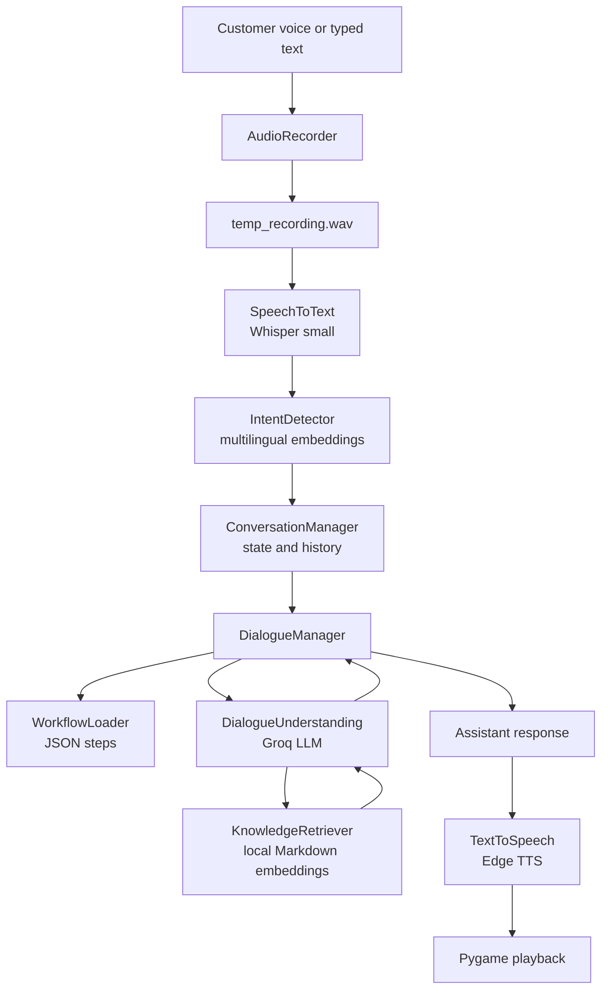
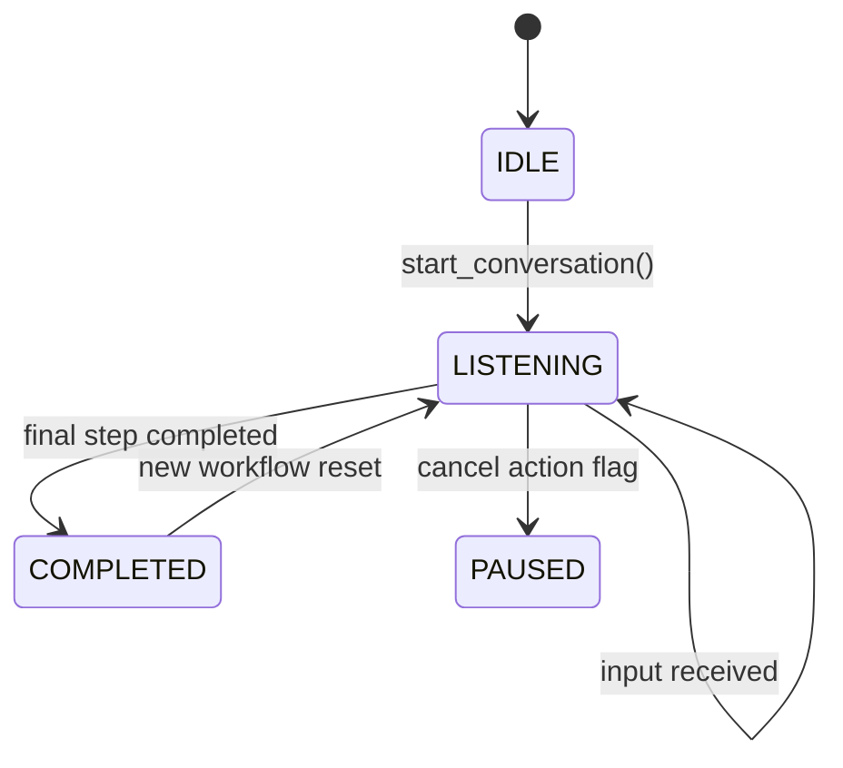

# Smart Banking Voice Assistant

## 1. Overview

This repository contains a Python desktop voice assistant prototype for common banking branch tasks. It accepts spoken input, converts speech to text, detects the requested banking service, guides the customer through a predefined workflow, answers banking questions from local Markdown knowledge, and can read responses aloud.

The current implementation is a command-line application. It is not a web service, mobile application, database-backed banking system, or transaction-processing system. The workflows provide guidance only; they do not access accounts, verify identity, move money, or submit forms to a bank.

### Supported intent labels

- `deposit money`
- `withdraw money`
- `check account balance`
- `apply for loan`
- `open new account`

### Currently executable guided workflows

- Deposit: `app/workflow/workflows/deposit.json`
- Withdrawal: `app/workflow/workflows/withdraw.json`
- Loan application: `app/workflow/workflows/apply_for_loan.json`

`check account balance` has an intent label but no workflow mapping in the interactive loop. `open new account` is mapped to `account_opening`, but `account_opening.json` is absent, so the workflow loader returns no workflow for it.

## 2. Technology Stack

| Area | Technology used | Role |
|---|---|---|
| Language | Python | Application and module implementation |
| Runtime | Python 3.13 appears to be used by the checked-in virtual environment | Local execution environment |
| Audio input | `sounddevice` | Records mono microphone audio |
| WAV writing | `scipy.io.wavfile.write` | Saves recordings as WAV files |
| Speech recognition | OpenAI Whisper Python package, model `small` | Converts audio to text locally |
| Text embeddings | `sentence-transformers` | Semantic intent and knowledge matching |
| Intent model | `paraphrase-multilingual-MiniLM-L12-v2` | Matches multilingual user text to intent labels |
| Action model | `all-MiniLM-L6-v2` | Legacy/local semantic action detector |
| Similarity | `scikit-learn` cosine similarity and NumPy | Ranks intent matches |
| LLM provider | Groq Python SDK | Calls the dialogue understanding and question-answering model |
| LLM model | `openai/gpt-oss-20b` | Structured message classification and grounded answers |
| Structured output | Groq/OpenAI-compatible JSON schema response format | Forces the understanding response into a defined schema |
| Knowledge format | Markdown files | Local banking facts and policies |
| Knowledge retrieval | Sentence embeddings plus dot-product ranking | Selects relevant Markdown documents |
| Text to speech | `edge-tts` | Generates MP3 speech using Microsoft Edge online voices |
| Audio playback | `pygame` mixer | Plays generated MP3 files |
| Translation | Custom `Translator` class | Currently pass-through; no actual translation service is connected |
| Data formats | JSON | Workflow definitions and LLM structured output |

There is currently no `requirements.txt`, `pyproject.toml`, or other dependency lockfile in the project root. Install packages manually or create a dependency file before sharing or deploying the project.

## 3. High-Level Architecture



## 4. End-to-End Runtime Flow

### 4.1 One-shot application path

The normal application entry point is `app/main.py`.

1. `main()` creates `VoiceAssistantPipeline`.
2. Pipeline initialization creates:
   - `AudioRecorder`
   - `SpeechToText`
   - `IntentDetector`
   - `ConversationManager`
   - `DialogueManager`
3. `run()` records approximately six seconds from the default microphone.
4. Whisper transcribes the temporary WAV file using English by default.
5. The intent detector embeds the recognized text and all intent labels, then selects the label with the highest cosine similarity.
6. The conversation is reset and marked as listening.
7. The detected intent is stored and passed to the workflow loader.
8. The user text is added to conversation history.
9. `DialogueManager.generate_response()` returns an instruction or fallback response.
10. The result is printed by `main()`.
11. The user can run another independent one-shot interaction by entering `y`.

Important: this path does not call `TextToSpeech`, does not use the translation module, and does not continue the same workflow across multiple user turns. It is a single recording, detection, and response cycle.

### 4.2 Interactive conversation path

The more complete loop is `debugging/test_full_pipeline.py`, despite its name. It supports typed or voice input, multiple turns, workflow progression, and TTS.

1. It initializes Whisper, TTS, recorder, intent detection, conversation state, and dialogue management.
2. The user selects English, Kannada, or Hindi.
3. The user selects voice input or typed input.
4. For voice input, the recorder captures audio and Whisper transcribes it using the selected language code.
5. The temporary recording is deleted after transcription.
6. Empty input is ignored.
7. `exit`, `quit`, `stop`, or `goodbye` exits the loop.
8. If there is no active intent, or the previous workflow is complete, semantic intent detection runs.
9. The detected intent is mapped to a workflow name:

   ```python
   {
       "withdraw money": "withdraw",
       "deposit money": "deposit",
       "apply for loan": "loan",
       "open new account": "account_opening",
   }
   ```

10. If a workflow exists, the conversation is reset, the intent/workflow is loaded, and the first instruction is returned.
11. On later turns, `DialogueManager` sends the current instruction and user message to the Groq model.
12. The structured LLM result controls cancellation, repetition, questions, information handling, and step completion.
13. The response is printed and, in voice mode, sent to Edge TTS and played through Pygame.

## 5. Module-by-Module Explanation

### `app/main.py`

Application entry point for the one-shot pipeline. It prints a session summary containing recognized text, language, detected intent, confidence, and response. It catches runtime exceptions at the top level and asks whether to continue.

Run it from the repository root with:

```powershell
python -m app.main
```

### `app/pipeline/voice_pipeline.py`

Defines `VoiceAssistantPipeline`, the orchestration layer for one interaction. It wires recording, STT, intent detection, conversation state, and dialogue generation together. It returns a dictionary containing:

- `text`
- `language`
- `intent`
- `confidence`
- `response`
- `conversation`

The returned `conversation` value is the state dictionary produced by `ConversationManager.get_context()`.

### `app/speech/recorder.py`

`AudioRecorder` uses `sounddevice` with these defaults:

- Duration: 6 seconds
- Sample rate: 16,000 Hz
- Channels: 1
- Data type: `float32`
- Output: `temp_recording.wav`

`record()` waits for the recording to finish and writes the WAV file. `cleanup()` removes it when possible. The fixed filename means concurrent sessions are not supported safely.

### `app/speech/stt.py`

`SpeechToText` loads Whisper's `small` model during initialization. `transcribe(audio_path, language="en")` calls Whisper with `fp16=False`, which is suitable for CPU execution, and returns:

```python
{
    "text": "recognized text",
    "language": "en"
}
```

The returned language is the requested language argument; the class does not independently detect the language. The Whisper model is downloaded/cached by the installed Whisper package on first use.

### `app/speech/tts.py`

`TextToSpeech` initializes `pygame.mixer` and uses `edge_tts` to create a temporary MP3. Supported voice mappings are:

- `en`: `en-IN-NeerjaNeural`
- `kn`: `kn-IN-SapnaNeural`
- `hi`: `hi-IN-SwaraNeural`

Language values such as `en-US` are reduced to `en`. Unknown languages fall back to the English voice. Audio generation requires network access because Edge TTS is an online service. The generated MP3 is unloaded and deleted after playback.

### `app/translation/translator.py`

The translator is an interface placeholder. It normalizes language names and supports language codes `en`, `kn`, `hi`, and `tcy`, but when source and target languages differ it returns the original text unchanged. No translation model, API, or language conversion is currently implemented.

### `app/intent/intents.py`

Contains the fixed list of intent labels. These labels are also the semantic examples used by `IntentDetector`.

### `app/intent/detector.py`

`IntentDetector` loads `paraphrase-multilingual-MiniLM-L12-v2`, embeds the five intent labels once, embeds the user text, and chooses the label with maximum cosine similarity. It returns a rounded confidence score, but there is no minimum confidence threshold or `unknown` intent fallback.

Consequently, every non-empty input is assigned one of the five labels, even if the request is unrelated to banking.

### `app/intent/action_detector.py`

Defines a separate embedding-based `ActionDetector` using `all-MiniLM-L6-v2`. It compares user text against phrase groups for `next_step`, `repeat`, `help`, and `complete`, with a threshold of `0.55`.

This class is not used by `VoiceAssistantPipeline`, `DialogueManager`, or the interactive full pipeline. Current action decisions come from the Groq LLM instead.

### `app/conversation/state.py`

Defines the `ConversationState` enum:

- `IDLE`
- `LISTENING`
- `PROCESSING`
- `SPEAKING`
- `WAITING`
- `PAUSED`
- `COMPLETED`

The enum provides vocabulary for lifecycle states. The current managers only explicitly set `LISTENING`; most other values are defined but not actively driven by the runtime.

### `app/conversation/manager.py`

`ConversationManager` stores the in-memory session:

- Current state
- Current intent
- Current workflow name
- Current step number
- Selected language
- Completed/cancelled flags
- Speaker/message history

`start_conversation()` resets the session and sets state to `LISTENING`. `set_intent()` stores the semantic intent. `load_workflow()` stores a workflow name and sets `current_step` to `1`. `get_context()` returns a serializable snapshot.

The manager does not persist state to disk or a database. A process restart loses all conversation history.

### `app/dialogue/manager.py`

`DialogueManager` is the deterministic control layer around workflow steps and LLM classifications.

Its main behavior is:

1. Ask for a banking service if no intent is active.
2. Load the JSON workflow for the current intent.
3. Report an unavailable workflow when loading fails.
4. Return the current instruction when no new user input exists.
5. Ask `DialogueUnderstanding` to classify user input.
6. Handle actions in this order:
   - `cancel`: mark the conversation cancelled.
   - `repeat`: return the requested step or current step.
   - acknowledgement: repeat the current instruction without advancing.
   - `help` or `question`: answer from retrieved knowledge without changing the step.
   - `next_step`: return the current instruction without assuming completion.
   - `complete`: increment the step, or mark the workflow complete.
   - information: report that the information was noted, but keep the current step.
   - unknown/uncertain: repeat the instruction and ask the user to continue when ready.

A notable design choice is that questions are processed before `next_step`. This protects workflow state when a user asks questions such as where or why something is required.

`handle_information()` currently prints extracted entities but does not store them in conversation state or use them to populate forms.

### `app/dialogue/llm/dialogue_understanding.py`

This class requires the `GROQ_API_KEY` environment variable at initialization. It creates a Groq client and a `KnowledgeRetriever`.

#### Structured understanding

`understand()` sends the current workflow, current step, current instruction, and customer message to `openai/gpt-oss-20b`. Temperature is `0`. The response must match this JSON schema:

```json
{
  "type": "workflow_action | acknowledgement | help | question | information | control | unknown",
  "action": "next_step | complete | repeat | cancel | explain | provide_information | none",
  "entities": {
    "amount": "number or null",
    "account_number": "string or null",
    "name": "string or null",
    "phone_number": "string or null",
    "step_number": "integer or null"
  }
}
```

The prompt tells the model not to invent values, to distinguish acknowledgements from completion, to extract explicit banking entities, and to preserve the workflow step when answering questions.

The JSON is parsed with `json.loads()`. String values equal to `null` are normalized to Python `None`. If parsing fails, a fallback result of type `unknown` and action `none` is returned. The fallback currently omits the schema's `step_number` entity, which is a small consistency gap.

#### Question answering

`answer_question()` retrieves the two most relevant local knowledge documents, places their content in the LLM prompt, and asks the same Groq model for a short voice-friendly answer. The prompt requires that factual claims be supported by retrieved knowledge or the active workflow and says to acknowledge insufficient information instead of inventing bank-specific facts.

### `app/knowledge/loader.py`

Loads every `.md` file under `app/knowledge/documents` using UTF-8 and returns a list of `{source, content}` dictionaries. Files are loaded as whole documents; there is no chunking, metadata extraction, or database index.

### `app/knowledge/retriever.py`

Loads `paraphrase-multilingual-MiniLM-L12-v2`, embeds all knowledge documents with normalized embeddings, and ranks documents by the dot product between normalized query and document vectors. `search(query, top_k=2)` returns source, content, and floating-point score.

The current knowledge base contains:

- `account_opening.md`
- `deposit.md`
- `loan.md`
- `withdrawal.md`

### `app/workflow/loader.py`

Maps a workflow name to a JSON file by lowercasing it, removing the exact suffix ` money`, replacing spaces with underscores, and appending `.json`.

Examples:

- `withdraw money` -> `withdraw.json`
- `deposit money` -> `deposit.json`
- `apply for loan` -> `apply_for_loan.json`

A missing file produces a message and returns `None`.

## 6. Workflow Definitions

Each workflow JSON file has a workflow name and an ordered `steps` array. Every step has a numeric `step` and an `instruction` string.

### Withdrawal

1. Take a withdrawal slip.
2. Fill in the account number.
3. Enter the withdrawal amount.
4. Sign the withdrawal slip.
5. Submit the slip to the cashier.

### Deposit

1. Take a deposit slip.
2. Fill in the account number.
3. Enter the deposit amount.
4. Submit the slip with the cash.

### Loan application

1. Proceed to the loan assistance desk.
2. Collect the loan application form.
3. Keep identity documents ready.

To add a workflow:

1. Add a JSON file under `app/workflow/workflows/`.
2. Name it using the normalized workflow name.
3. Add a mapping in the interactive loop if intent detection should start it.
4. Add related factual information to `app/knowledge/documents/` if questions about it need grounded answers.
5. Add a focused debugging test.

## 7. Conversation State Machine



The conceptual enum includes processing and speaking states, but the current code does not transition into them. The `completed` and `cancelled` booleans are the active workflow control flags.

## 8. External Services and Runtime Requirements

### Required local capabilities

- Python environment with the required packages installed
- Working microphone for voice input
- Working audio output device for TTS playback
- Windows audio drivers supported by `sounddevice` and `pygame`
- Enough disk space for Whisper and Sentence Transformers model caches

### Required network access

- First-time model downloads may need internet access.
- Groq API calls require internet access and a valid API key.
- Edge TTS audio generation requires internet access.

### API key setup in PowerShell

Set the Groq key for the current terminal session:

```powershell
$env:GROQ_API_KEY = "your-groq-api-key"
```

For a persistent user-level variable, configure it outside the repository using the Windows environment-variable settings or PowerShell's `setx` command. Do not commit the key to source control.

## 9. Installation and Running

The repository does not currently declare dependencies in a requirements file. From the repository root, create/activate the existing virtual environment and install the packages used by the imports:

```powershell
.\venv\Scripts\Activate.ps1
python -m pip install --upgrade pip
python -m pip install sounddevice scipy openai-whisper sentence-transformers scikit-learn numpy groq edge-tts pygame pyttsx3
```

`pyttsx3` is only used by the standalone `test_voice.py` voice-listing utility; the assistant itself uses Edge TTS.

Run the one-shot application:

```powershell
$env:GROQ_API_KEY = "your-groq-api-key"
python -m app.main
```

Run the interactive voice/text workflow loop:

```powershell
$env:GROQ_API_KEY = "your-groq-api-key"
python debugging\test_full_pipeline.py
```

Run a module-level diagnostic from the repository root. Because imports use the `app` package, run these commands from the root directory:

```powershell
python debugging\test_intent.py
python debugging\test_workflow.py
python debugging\test_knowledge.py
python debugging\test_retriever.py
python debugging\test_dialogue.py
```

LLM-dependent diagnostics require `GROQ_API_KEY`:

```powershell
python debugging\test_dialogue_understanding.py
python debugging\test_question.py
```

Audio diagnostics require a microphone or speakers as appropriate:

```powershell
python debugging\test_stt.py
python debugging\test_tts.py
```

There is no automated test runner configuration visible in the repository. The files under `debugging/` are executable scripts and mostly print results rather than using `pytest` assertions.

## 10. File Structure

```text
language_engine/
|-- app/
|   |-- main.py
|   |-- conversation/
|   |   |-- manager.py
|   |   |-- state.py
|   |-- dialogue/
|   |   |-- action_detector.py
|   |   |-- manager.py
|   |   |-- llm/
|   |       |-- dialogue_understanding.py
|   |-- intent/
|   |   |-- detector.py
|   |   |-- intents.py
|   |-- knowledge/
|   |   |-- loader.py
|   |   |-- retriever.py
|   |   |-- documents/
|   |       |-- account_opening.md
|   |       |-- deposit.md
|   |       |-- loan.md
|   |       |-- withdrawal.md
|   |-- pipeline/
|   |   |-- voice_pipeline.py
|   |-- speech/
|   |   |-- recorder.py
|   |   |-- stt.py
|   |   |-- tts.py
|   |-- translation/
|   |   |-- translator.py
|   |-- workflow/
|       |-- loader.py
|       |-- workflows/
|           |-- apply_for_loan.json
|           |-- deposit.json
|           |-- withdraw.json
|-- assets/
|   |-- audio/
|       |-- sample.wav
|-- debugging/
|   |-- test_*.py
|-- test_voice.py
|-- project_structure.txt
|-- VOICE_ASSISTANT_DOCUMENTATION.md
|-- venv/
```

The `venv/`, Python cache directories, generated recordings, and generated TTS files are environment artifacts and should normally be excluded from version control.

## 11. Current Limitations and Risks

1. **Two separate runtime designs:** `app/main.py` uses a one-shot pipeline, while `debugging/test_full_pipeline.py` contains the multi-turn workflow loop. Behavior is not identical between them.
2. **No actual transactions:** The assistant only gives instructions. It does not connect to banking systems or validate customer data.
3. **No confidence rejection:** Intent detection always chooses a label. Add a calibrated threshold and an unknown/fallback path for unrelated or low-confidence input.
4. **Missing account-opening workflow:** `account_opening.md` exists, but `account_opening.json` does not.
5. **Balance intent is incomplete:** `check account balance` is recognized but is not mapped to a workflow in the interactive path.
6. **Translation is not implemented:** Different source and target languages return unchanged text.
7. **Language is not retained consistently:** The interactive loop uses a selected language for STT and TTS, but `ConversationManager.language` remains at its default unless explicitly updated elsewhere.
8. **Extracted entities are not persisted:** Amount, account number, name, and phone number are printed or returned by the LLM but are not stored in the conversation state.
9. **Fixed recording filename:** `temp_recording.wav` can collide across concurrent processes and may remain after abnormal termination.
10. **Temporary TTS artifacts:** Generated MP3 cleanup is best-effort and can fail if the file remains locked.
11. **Model startup cost:** Whisper and embedding models load during object construction, which makes startup slow and memory-intensive.
12. **External LLM dependency:** Dialogue understanding and question answering fail without `GROQ_API_KEY` and network access.
13. **Knowledge quality is limited:** Retrieval uses four full documents and simple vector ranking. There is no document versioning, chunking, citations in the spoken response, or source freshness mechanism.
14. **Schema fallback mismatch:** The invalid-JSON fallback omits `step_number`, although the normal schema requires it.
15. **State enum is only partly implemented:** Processing, speaking, waiting, paused, and completed lifecycle transitions are not consistently represented in `ConversationState`.
16. **No automated assertions:** Debugging scripts are useful for manual checks but do not reliably prevent regressions.

## 12. Recommended Next Improvements

### Reliability

- Add `requirements.txt` or `pyproject.toml` with pinned compatible versions.
- Add `.gitignore` entries for `venv`, caches, recordings, MP3 files, and secrets.
- Validate microphone/audio-device availability and handle timeouts.
- Use unique temporary files and guaranteed cleanup.
- Add structured logging instead of relying only on `print()`.

### Conversation quality

- Consolidate the one-shot and multi-turn execution paths into one service.
- Store extracted entities in conversation state.
- Define explicit transitions for processing, speaking, waiting, cancellation, and completion.
- Add an intent confidence threshold and a general-help fallback.
- Replace LLM action interpretation with a validated domain command layer or validate every LLM result before mutation.

### Feature completion

- Add `account_opening.json`.
- Add a balance-check workflow or remove the unused intent until it is supported.
- Implement translation through a selected local model or external translation service.
- Add real form/application integration only behind authenticated, audited banking APIs.

### Testing

- Convert debugging scripts to `pytest` tests with mocks for Whisper, Groq, Edge TTS, microphone input, and Pygame.
- Test every workflow transition, repeat-by-step behavior, cancellation, question handling, invalid workflow, malformed LLM JSON, and low-confidence intent.
- Add tests confirming that questions do not advance a workflow and that extracted entities are retained once storage is implemented.

## 13. Quick Mental Model

A useful way to understand the system is to separate three responsibilities:

- **Recognition:** recorder, Whisper, and intent embeddings determine what the customer said and which broad banking service they mean.
- **Control:** conversation state, workflow JSON, and `DialogueManager` decide which instruction is active and whether it may advance.
- **Understanding and facts:** Groq interprets natural-language responses, while local Markdown retrieval supplies factual banking context for questions.

The assistant is therefore a local workflow engine with AI-assisted language understanding around it. The AI does not itself own the workflow state: `DialogueManager` makes the final state-change decisions after reading the structured LLM result.
